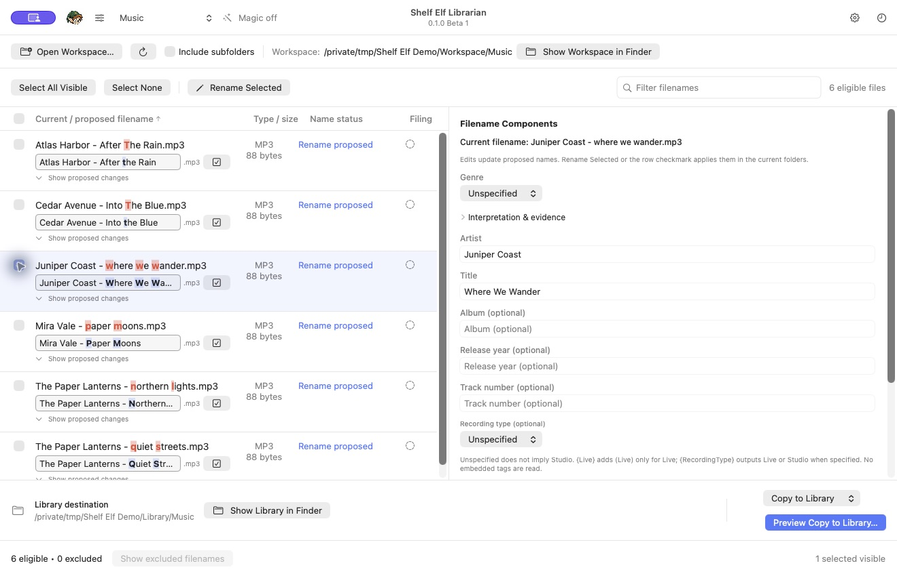
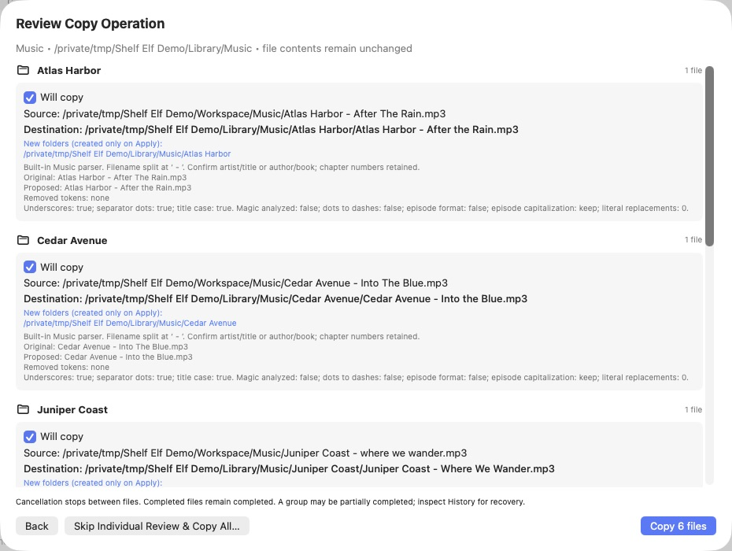

# Shelf Elf Librarian

<p align="center">
  
</p>

**0.1.0 Beta 1** · Native macOS 14+ · SwiftUI/AppKit · Apple Silicon download

Your libraries, neatly shelved.

Shelf Elf Librarian helps you review filenames, rename selected files, and copy or move them into organized libraries. Profiles define how to read existing names, build proposed names, and choose destination folders. Processing stays local: no accounts, telemetry, online identification service or unattended filing.

## Workspace preview



Review proposed filename changes beside editable components before applying an operation.



Copy/Move previews show destination groups and blocked rows before confirmation. These screenshots use the isolated screenshot edition with fictional filename-only fixtures and demo library paths; no personal media or production settings are shown.

## Download and run

Download the main **Shelf Elf Librarian** app from [GitHub Releases](https://github.com/natsteff/shelf-elf-librarian/releases/tag/v0.1.0-beta.1), unzip it, and open it on an Apple Silicon Mac running macOS 14 or later.

This beta is locally ad hoc signed, **not Developer ID signed or notarized**. macOS may require approval through Finder’s Open action or System Settings → Privacy & Security. There is no automatic updater. Quit an older running copy before opening a replacement.

The Beta 1 release also includes a **Fresh Install Test** edition with separate preferences, profiles and history. Use the main app normally; use the test edition only to examine first-run behavior and starter defaults. Neither edition includes your own library files or settings.

## What it does

- **Review and rename:** editable filename proposals, red/blue difference highlighting, spelling suggestions, shared preferred spellings, title casing and targeted replacement rules.
- **Organize libraries:** ordered filename patterns, editable components, folder/filename masks and classification-specific layouts. Copy/Move previews group files by destination folder.
- **Route mixed videos:** optional Media Categories map movies, TV shows, documentaries and other categories to your own library folders. Categories can be added, removed and customized.
- **Inspect metadata:** view MP3 ID3/APE tags and differences; use supported video metadata to supplement missing components.
- **Maintain MP3 tags:** explicitly review updates from filename components or purge unwanted tags using a configurable keep list, including artwork.
- **Run Magic:** optional local interpretation using filenames, parent-folder and selected-file evidence, plus explicitly remembered corrections. Every run requires confirmation before library filing.
- **Keep control:** selected visible files only, collision checks, source verification, operation history and guarded Undo where supported.

## Start with a workspace

1. Select a profile and choose **Open Workspace…**. Its extension filter determines which files appear; **Include subfolders** controls recursive discovery.
2. Open **Profile Settings** and use **Choose Library Location…**. Configure the profile’s patterns and folder/filename masks as needed.
3. Select files and review **Filename Components**. Component edits change proposals without touching files. Confirm the interpreted components before normal filing.
4. Use **Rename Selected** or a row’s checkmark to apply proposed names in the current folders. A manually edited filename is applied with Enter; Esc cancels uncommitted editing.
5. To file into the library, choose Copy or Move and open its preview. Review destination groups, new folders and blocked rows, then explicitly confirm. The optional **Keep Current Filenames** path skips individual component confirmation but still uses folder masks and validates destinations.

**Copy** is the initial default; General Settings can change it. Successful operations deselect completed files; failed, blocked and unprocessed files remain selected. Moves rescan the workspace, including after partial completion or cancellation.

The last workspace and profile restore on launch, but selections and pending operations do not resume. Refresh rereads files and tags and recomputes ordinary proposals; it does not run Magic. Review pending work before refreshing or changing settings.

If a configured library folder has been replaced at the same path, the app asks you to confirm **Use This Folder**, saves its new identity and rebuilds the preview. Execution still needs confirmation.

## Profiles, components and masks

Nine starter profiles are supplied on new installs: **Video Media Server, Music, Audiobooks, FORGE, ROMs, Photos, PDF Library, Software & Installers, and Ebooks & Comics**. Their destinations must be chosen by you.

A profile has three related definitions:

| Setting | Purpose | FORGE example |
| --- | --- | --- |
| Input pattern in **Workspace Filename Patterns & Filing Types…** | Read an existing basename into components | `{GameTitle} - {ResourceName}` |
| **Folder mask** | Build folders beneath the library location | `{GameTitle}` |
| **Filename mask (without extension)** | Build the proposed basename | `{GameTitle} - {ResourceName}` |

Input patterns match the entire basename in order; the first enabled match wins. They can explicitly read parent folders instead. Output masks use `{Component}` placeholders plus fixed text and separators. `/` separates folder levels; `{SeriesName?}` omits an empty optional level. The original extension is added automatically. Missing required components block the affected file.

Documents profiles can define custom components directly in input patterns, then edit their values and use them in output masks. Music and Video use built-in filename parsers, component definitions and metadata mappings; saved input patterns cannot disable or replace them. Their settings expose filing Types and output layouts instead of input-pattern editing. Type, System or Genre mappings can override the profile’s layouts.

For audiobooks, `{SeriesName}` aliases `{Series}`. The starter folder mask is `{Author}/{SeriesName?}/{BookFolder}`; BookFolder prefixes BookTitle with SeriesNumber when present. Filename patterns support numbered and unnumbered series. Author, book and chapter fields can also be entered manually.

Changing a content type preserves existing rules until **Load defaults for this content type** is used. **Save** commits a profile draft; **Cancel** discards it. Deleting a profile does not delete library files. **Tools → Export Settings… / Import Settings…** transfers profile and General Settings; import confirms replacement and backs up existing settings first. Before committed profile or General Settings changes, the app keeps the newest 10 complete pre-change snapshots locally. Use **Tools → Restore Settings Backup…** to choose a snapshot by date/time and reason; restoring also backs up the current configuration first. Backup failure stops the save. Manual export remains the primary portable backup. See the [automatic settings backup guide](docs/SETTINGS-BACKUPS.md).

See the [filename pattern and layout guide](docs/FILENAME-PATTERNS.md).

### Spelling and cleanup

General Settings holds shared preferred spellings and the editable **Universal lowercase title words** list. Enable **Title case** and **Smart title case** in a profile to use that word list. Preferred spelling/case exceptions apply across profiles; explicit removable labels take precedence.

Filename hyphen-to-space conversion and whole-episode filename lowercasing have been removed. Use targeted replacement rules for deliberate conversions. Season/episode formatting and capitalization remain separate options. Music’s leading-“The” artist formatting and bucket-only ignore option are independent and default off. Number/symbol bucket settings and bucket-only leading-“The” handling are shown only while first-letter buckets are enabled; disabling buckets retains their values. Individual-track folders and artist formatting remain independent.

### Media Categories for video

Enable Media Categories to map each category to a library subfolder of your choosing, or explicitly to the library root. The six starter categories are Commercials, Documentaries, Home Videos, Movies, Music Videos and TV Shows. Recognition uses configured types and rules; you can override a file’s category manually. Unmatched videos can require review, use a chosen category, or use the library root.

Category routing chooses the destination branch; folder masks create further folders within it. Existing folders are reused. Missing folders are created only when an operation is applied. Removing a category does not delete files or folders.

### ROM organization

ROM profiles preserve original filenames, including punctuation, case and release markers. Clear extension mappings infer System: for example `.nes` → NES, `.sfc`/`.smc` → SNES and `.gba` → Game Boy Advance. Edit mappings under **Workspace Filename Patterns & Filing Types…**, then configure each System’s library folder or inherit the `{System}` folder mask.

Shared extensions such as `.iso`, `.bin`, `.chd`, `.zip` and `.7z` have no default system inference. Read `{System}` from an explicit filename or parent-folder pattern, or choose it manually. Explicit captured values take priority over extension mappings; differences are noted for review. No ROM contents or archives are inspected.

Folders containing disc descriptors or playlists (`cue`, `m3u`, `m3u8`, `gdi`, `ccd`, `mds`) are conservatively blocked from individual copy, move and rename operations. Linked sets need to stay together; coordinated set-level filing is not implemented. A deliberate manual filename edit remains possible for standalone ROM files.

## Metadata and MP3 tools

The tag icon beside a filename or in Filename Components opens discovered metadata. Differences appear first, followed by mapped fields in relevance order—Artist, Title, Album, Release Year and Track Number—then other tags. Long values are collapsed; artwork is identified without loading images.

MP3 tags never automatically replace filename components. **Use Tag for…** stages a chosen value for that file. The popup stays open for more choices; **Review Proposed Filename** focuses the row. Enter renames the file; Esc restores the proposal and components from before those tag choices. This action does not write tags.

Music profiles offer two separate Tools actions for selected visible MP3 files:

- **Update MP3 Tags from Components…** previews missing/differing Artist, Title, Album, Year, Track Number and Genre tags. Nonempty components supply values; blank components never erase tags. All proposed changes start checked; uncheck fields or files as needed.
- **Purge Other MP3 Tags…** previews removals based on **MP3 Tags to Keep on Purge** in Profile Settings. Every keep option defaults on, including artwork, comments, lyrics and other/custom tags, so the initial policy removes nothing.

Both actions require confirmation. They preserve audio bytes, revalidate source files and block unsupported or unsafe tag layouts. They have **no Undo or retained file backup**. Some legacy or protected tag layouts require another editor first. Non-MP3 selections are skipped. Use a dedicated tag editor such as TagCraft for broader metadata editing.

For **MP4, M4V and MOV**, locally readable metadata can fill missing components referenced by the active output masks. Existing filename values and manual edits take priority. Supported fields include title, year, series, season, episode, episode title, genre and display dimensions. Other video containers retain filename interpretation. Video metadata is read-only; photo EXIF is not read. **Use common resolution shorthand** defaults on in Video Profile Settings: actual dimensions map to the closest common size tier (480p, 720p, 1080p, 4K or 8K). Disable it to keep full display dimensions. Cropped and portrait video use both dimensions for tier selection. The p suffix is conventional size shorthand, not verified scan type; dimensions do not establish DVD or Blu-ray origin. Existing explicit resolution labels remain unchanged.

## Magic

Enable **Magic for this profile**, select visible files and click **Run Magic**. It analyzes locally and opens a mandatory Copy/Move confirmation with profile, destination names, file counts and enabled tag steps. Nothing is filed until you confirm. Discovery, refresh and profile changes never run Magic automatically.

Music profiles have two additional default-off options: update MP3 tags from components, and purge tags using the keep list. The order is:

1. Prepare filename components and proposed names.
2. Update selected supported tags on a private library staging copy, if enabled.
3. Purge unwanted tags, if enabled.
4. Publish the completed library file; for Move, remove the unchanged source only after successful preparation and publication.

Purge wins if an updated field is outside the keep list. Copy leaves workspace originals unchanged. Tag-step failures block publication of that file. Ordinary Copy/Move previews do not run these optional tag steps. Magic operations that change tags have **no automatic Undo or retained backup**.

Explicitly remembered corrections are local and profile-scoped. Recommendations change drafts for review; learning does not apply settings or execute operations by itself.

## File operations, history and recovery

Previews freeze file identity, size, timestamps and SHA-256 along with parent/destination checks. Execution revalidates them. Collision checks and exclusive publication prevent replacing an existing destination; duplicate batch outputs and case/Unicode conflicts are blocked.

Local copies use verified temporary targets. SMB destinations are detected automatically, check reported free space for the estimated batch before starting, and use exclusive destination creation followed by content verification, avoiding protected rename operations that may be unsupported by the share. Interrupted SMB transfers can leave incomplete files under their final names; sources are retained on failure. Magic tag changes are prepared on a staging copy before exclusive publication to SMB. A notice appears the first time a library is selected per saved profile, and red guidance remains beneath its location in Profile Settings. Existing SMB destinations are never overwritten. Ordinary same-volume moves can use exclusive rename; cross-volume and tag-changing Magic moves use verified-copy preparation. Cancellation stops between files, so earlier successful operations remain completed. Batches are not atomic. Copy/Move confirmation dialogs stay open during transfer, then show completed/failed counts and any errors until Done is selected. Cancel Transfer stops between files; completed files remain completed.

**History & Recovery** records per-file results and interrupted operations, including reported staging/recovery paths. Guarded Undo is available only for supported operations and refuses changed files or occupied original paths. It is not a full file-backup system. Cross-volume undo requires a new reviewed operation; tag updates/purges have no Undo.

Operation history expires after **30 days**. Explicitly remembered corrections persist separately. History cleanup does not delete source, destination, partial or recovery files. Automatic settings snapshots are separate and retain the newest 10; manual exports and historical migration/import backups outside that folder are not rotated.

**Tools → Clean Folder Names…** previews renaming selected direct child folders with their contents. It does not recursively reorganize folders.

## Development disclaimer

Shelf Elf Librarian was developed using **OpenAI Codex**, with human direction and review. AI-assisted development and automated tests do not guarantee error-free behavior. This is beta software; test changes on disposable copies with independent backups before renaming, moving, or updating or purging tags in an original library.

## Beta limitations and validation

Start with disposable files and keep backups of important originals. Beta 1 passes **99 disposable fixture scenarios** covering planning, execution, source/collision guards, cancellation, supported Undo, patterns, custom components, metadata, MP3 writes, Magic tag steps and history retention. These checks are not a release-safety certification; native GUI review remains manual.

Known limits include concurrent directory-replacement races, network filesystem behavior, actual cross-volume/hardware failures and full attribute fidelity across differing filesystems. Automatic crash rollback/cleanup, coordinated sidecar/ROM sets, video tag writing, archive extraction, transcoding, full-library inventory and unattended filing are not implemented.

See [validation scope](VALIDATION.md) for details.

## Build from source

Use a Mac with a Swift 6 toolchain and the macOS SDK:

```sh
./scripts/build.sh
open "outputs/Shelf Elf Librarian.app"
```

The script builds the app and standalone fixture runner, runs the checks, generates license notices, packages the app and applies an ad hoc signature. It targets the build machine’s architecture; the supplied release is arm64, not a universal binary. The public label is **0.1.0 Beta 1**; release labels come from `Info.plist`. The internal build number is maintained separately for ordering.

For isolated starter-profile review:

```sh
./scripts/build-fresh-install-test.sh
```

Run the main build first. See the [fresh-install review guide](docs/FRESH-INSTALL-REVIEW.md).

## Local data and privacy

Profiles, bookmarks, preferences, remembered corrections and the SQLite journal stay on your Mac. The main app uses the stable identifier `com.local.LibraryFiler.Alpha`; its support data is under `~/Library/Application Support/`. The Fresh Install Test edition uses a separate identifier and data store. No library file contents, metadata or usage reports are automatically uploaded. GitHub links open only when selected.

## License & Usage Notice

Shelf Elf Librarian is free, open-source software under the [GNU Affero General Public License, version 3](LICENSE) (AGPL-3.0, version 3 only). There is no separate restrictive EULA or custom monetary liability cap.

The [License & Usage Notice](USAGE-NOTICE.md) explains file-operation and recovery considerations without adding restrictions to the license. The app displays it once per new app version/build or notice version, with access to the full license. **Continue** records acknowledgment locally; **Quit** exits without recording it. It can be reopened through **License & Usage Notice…** in the app menu.
